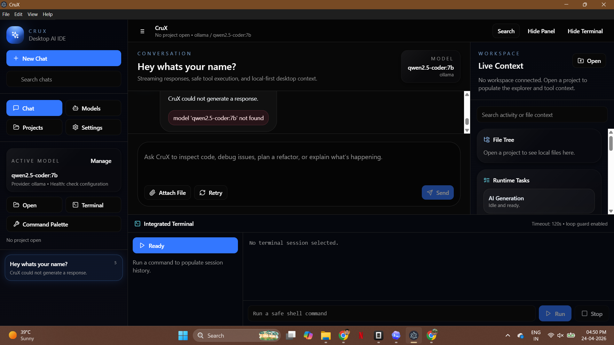

# CruX Desktop

CruX Desktop is an Electron-based AI coding workspace focused on practical developer productivity: chat-driven coding support, project context, and safe local tooling.

## Product Preview



## Why Recruiters Like This Project

- Real desktop product architecture (`frontend`, `electron`, `backend`, `shared`)
- TypeScript-first implementation across UI and services
- Local-first developer workflow with terminal and file tooling
- Packaging pipeline for distributable Windows builds

## What I Built

- Chat-centric AI IDE experience with model routing hooks
- Workspace/context panels for project-aware interaction
- Integrated terminal and execution controls
- Service-oriented backend modules for extensibility
- End-to-end Electron app packaging setup

## Tech Stack

- React + TypeScript
- Electron
- Node.js + TypeScript
- TailwindCSS
- ESLint

## Project Structure

```text
frontend/   React UI and application state
electron/   Main process, IPC, preload bridge
backend/    Agent and tooling services
shared/     Cross-layer types and constants
tests/      Integration and stress test scaffolds
```

## Quick Start

```bash
npm install
npm run dev
```

## Validation

```bash
npm run lint
npm run typecheck
```

## Build

```bash
npm run build
npm run package
```

## Limitations (Current)

- Local model/runtime setup may require machine-specific configuration
- Some advanced agent paths are still under active hardening

## Roadmap

- Improve model setup diagnostics and onboarding UX
- Add automated E2E CI pipeline
- Publish installer and versioned release notes per build

## Releases

- This repository tracks source code.
- Windows binaries are intended to be published in GitHub Releases.

## License

MIT
